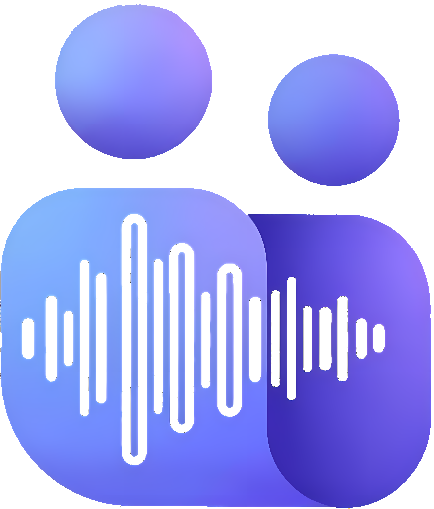

<p align="center">
  
</p>

<h1 align="center">TeamsMeetingRecorder</h1>

<p align="center">
  <strong>A bot that joins Microsoft Teams meetings and records the audio.</strong>
</p>

<p align="center">
  <a href="https://github.com/PianoNic/TeamsMeetingRecorder"></a>
  <a href="https://github.com/PianoNic/TeamsMeetingRecorder/blob/main/LICENSE"></a>
  <a href="https://github.com/PianoNic/TeamsMeetingRecorder/releases"></a>
  <a href="docs/self-hosting.md"></a>
</p>

> Not affiliated with Microsoft. Get consent from everyone in the meeting before you record it, see [Legal and privacy](#legal-and-privacy).

## Features

- **One call to record**: POST a meeting link, the bot joins as a guest, waits out the lobby, records until the meeting empties and leaves on its own.
- **Several meetings at once**: every session gets its own browser and audio sink, so recordings never mix.
- **Clean audio**: 48 kHz straight from the browser, as WAV or lossless FLAC at a fraction of the size.
- **Storage of your choice**: local disk, Azure Blob (or Azurite) or any S3-compatible bucket.
- **Webhooks**: a POST when a recording is done, optionally signed.
- **Safe to retry**: tag a join with your own reference and a repeated `/join` returns the running session instead of a second bot.
- **Speaks too**: play a file or a live stream into the meeting through the bot's microphone.

## Quick start

```bash
docker run -d -p 8000:8000 -v ./recordings:/app/recordings --shm-size=2gb --init \
  ghcr.io/pianonic/teamsmeetingrecorder:latest
```

```bash
curl -X POST http://localhost:8000/join \
  -H "Content-Type: application/json" \
  -d '{"meeting_url": "https://teams.microsoft.com/l/meetup-join/...", "display_name": "Recording Bot"}'
```

The recording lands in `./recordings` when the meeting ends. API docs at <http://localhost:8000/docs>.

## Documentation

- [Self-hosting](docs/self-hosting.md): Docker, Docker Compose and storage backends
- [Configuration](docs/configuration.md): environment variables
- [API](docs/api.md): endpoints, session status and retrying a join
- [Webhooks](docs/webhooks.md): what the bot sends when a session ends
- [Microphone](docs/microphone.md): playing files and live audio into a meeting
- [Development](docs/development.md): running from source and the tests

## Legal and privacy

Recording people has rules. Get explicit consent from every participant, tell them the meeting is recorded, follow your local privacy law (GDPR, CCPA and the like), and never expose the API publicly without `BOT_ACCESS_TOKEN`.

## License

[MIT](LICENSE)
