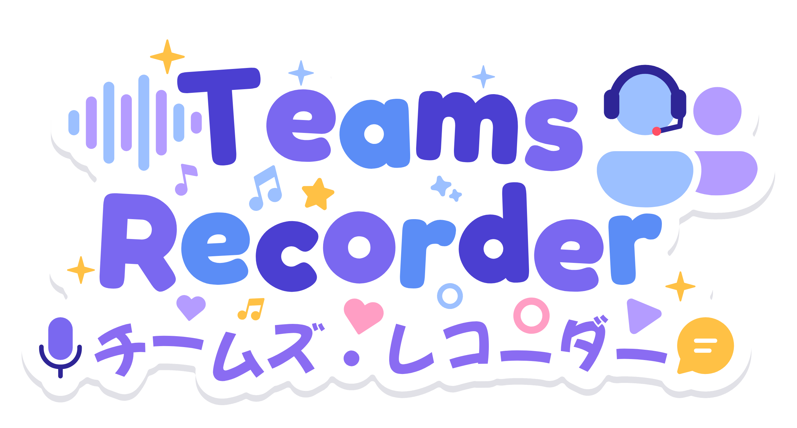

<p align="center">
  
</p>

<p align="center">
  <strong>A bot that joins Microsoft Teams meetings and records the audio.</strong>
</p>

<p align="center">
  <a href="https://github.com/PianoNic/TeamsRecorder"></a>
  <a href="https://github.com/PianoNic/TeamsRecorder/blob/main/LICENSE"></a>
  <a href="https://github.com/PianoNic/TeamsRecorder/releases"></a>
  <a href="https://docs.teamsrecorder.pianonic.ch/self-hosting"></a>
  <a href="https://docs.teamsrecorder.pianonic.ch"></a>
</p>

> Not affiliated with Microsoft. Get consent from everyone in the meeting before you record it, see [Consent and privacy](https://docs.teamsrecorder.pianonic.ch/privacy).

## Features

- **One call to record**: POST a meeting link, the bot joins as a guest, waits out the lobby, records until the meeting empties and leaves on its own.
- **Several meetings at once**: every session gets its own browser and audio sink, so recordings never mix.
- **Clean audio**: 48 kHz straight from the browser, as WAV or lossless FLAC at a fraction of the size.
- **Storage of your choice**: local disk, Azure Blob (or Azurite) or any S3-compatible bucket.
- **Webhooks that arrive**: a POST when a session ends and, if you want, at every step on the way. Retried until delivered, even across restarts.
- **Nothing gets stuck**: a session cut off by a crash or restart is reported on the next start, with everything it recorded until then.
- **Safe to retry**: tag a join with your own reference and a repeated `/join` returns the running session instead of a second bot.
- **Speaks too**: play a file or a live stream into the meeting through the bot's microphone.

## Quick start

```bash
docker run -d -p 8000:8000 -v ./recordings:/app/recordings --shm-size=2gb --init \
  ghcr.io/pianonic/teamsmeetingrecorder:latest
```

```bash
curl -X POST http://localhost:8000/join \
  -H "Content-Type: application/json" \
  -d '{"meeting_url": "https://teams.microsoft.com/l/meetup-join/...", "display_name": "Recording Bot"}'
```

The recording lands in `./recordings` when the meeting ends. API docs at <http://localhost:8000/docs>, the full guide at **[docs.teamsrecorder.pianonic.ch](https://docs.teamsrecorder.pianonic.ch/getting-started)**.

## Documentation

**[docs.teamsrecorder.pianonic.ch](https://docs.teamsrecorder.pianonic.ch)**

- [Getting started](https://docs.teamsrecorder.pianonic.ch/getting-started)
- [How a session works](https://docs.teamsrecorder.pianonic.ch/how-it-works): the lifecycle, every status, retrying a join safely
- [Self-hosting](https://docs.teamsrecorder.pianonic.ch/self-hosting): Docker, Docker Compose, Azure Blob and S3 storage
- [Configuration](https://docs.teamsrecorder.pianonic.ch/configuration): every setting
- [Webhooks](https://docs.teamsrecorder.pianonic.ch/webhooks): what the bot sends, and how to receive it
- [Microphone](https://docs.teamsrecorder.pianonic.ch/microphone): playing files and live audio into a meeting
- [Development](https://docs.teamsrecorder.pianonic.ch/development): running from source, tests, the docs site and releasing

## Legal and privacy

Recording people has rules. Get explicit consent from every participant, tell them the meeting is recorded, follow your local privacy law (GDPR, CCPA and the like), and never expose the API publicly without `BOT_ACCESS_TOKEN`. More in [Consent and privacy](https://docs.teamsrecorder.pianonic.ch/privacy).

## License

[MIT](LICENSE)
